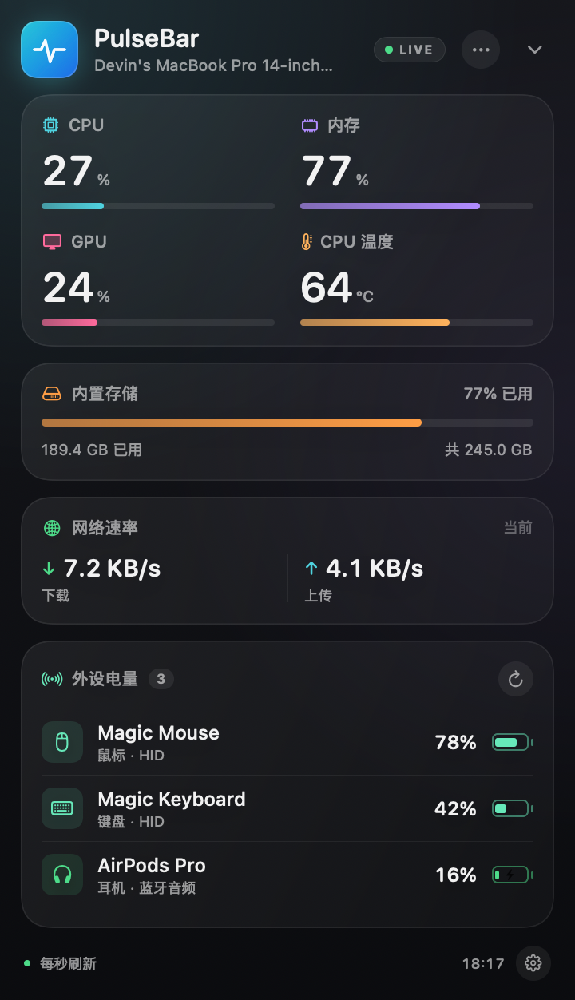

# PulseBar

**菜单栏里的 Mac 状态与外设电量面板。**

PulseBar 是一个原生 macOS 菜单栏工具：点开图标，一屏查看 CPU、内存、GPU、温度、存储、网络，以及妙控鼠标、妙控键盘、游戏手柄等外设的电量与充电状态。

设计灵感来自 [einsy1/pulse](https://github.com/einsy1/pulse)，但 PulseBar 是独立实现，并针对两个方向做了增强：**更清晰的信息层级 / 视觉**，以及 **Pulse 没有的外设电量中心**。

<p align="center">
  
  <br>
  <sub>界面预览（演示数据；真实读数取决于设备与系统）</sub>
</p>

> 当前状态：**M0 框架完成**。项目可编译、可运行、可测试；后续按 [roadmap.md](roadmap.md) 由 Cursor 继续实现。

---

## 为什么叫 PulseBar

- **Pulse**：延续“系统脉搏”的定位——CPU、内存、温度、网络都是机器的生命体征。
- **Bar**：菜单栏（menu bar）形态；同时点出新增的“外设电量条”。
- 简短、好读、好念；bundle id 使用 `com.dvnlandon.pulsebar`。

---

## 功能（当前 / 规划）

### 已实现（M0）

- 菜单栏常驻，左键打开面板，右键打开快捷菜单。
- 菜单栏标签：仅图标 / CPU / 内存 / 最低外设电量。
- 系统脉搏卡片：CPU、内存、GPU、CPU 温度（占位，读不到显示“—”）。
- 内置存储用量、网络下载/上传速率。
- 外设电量：HID（IORegistry）与 GameController 两个来源，合并、去重、30 秒轮询。
- 低电量标记、充电闪电、未知电量“—”、空状态。
- 设置：菜单栏显示、刷新频率、电量轮询、登录时启动。
- 深色设计系统、应用图标、ad hoc 签名 `.app` 构建。
- `--snapshot` 离屏渲染；`PULSEBAR_DEMO=1` 演示数据。
- 13 个单元测试。

### 下一步（详见 [roadmap.md](roadmap.md)）

- M1：采样移出主线程、真实 CPU 温度、外置磁盘、64 位网络计数、睡眠唤醒。
- M2：浅色主题、紧凑模式、历史曲线、可访问性、本地化。
- M3：电量 v1 加固、过期状态、手动测试矩阵。
- M4：CoreBluetooth GATT / AirPods / iPhone 电量研究（实验性）。
- M5：低电量通知、历史图、诊断导出。
- M6：CI、Developer ID 签名、公证、DMG 发布。

---

## 快速开始

**要求**：macOS 14+，Xcode 16+（或匹配的 Command Line Tools + macOS SDK）。

```bash
# 开发运行（菜单栏出现图标；右键菜单退出）
swift run PulseBar

# 演示模式：不需要真实外设即可看到电量 UI
PULSEBAR_DEMO=1 swift run PulseBar

# 运行测试
swift test

# 构建 .app（release，ad hoc 签名）
./build.sh
open PulseBar.app

# 生成演示截图（不打开窗口）
swift run PulseBar --snapshot docs/images/dashboard.png
```

> 受限环境（容器/CI）如果 SwiftPM 自身沙盒或模块缓存不可写，可使用：
> `PULSEBAR_LOCAL_CACHES=1 PULSEBAR_DISABLE_SANDBOX=1 ./build.sh`。

### 常用 Make 目标

```bash
make run         # swift run PulseBar
make demo        # PULSEBAR_DEMO=1 swift run PulseBar
make test        # swift test
make build       # ./build.sh
make universal   # UNIVERSAL=1 ./build.sh
make snapshot    # 重新生成 docs/images/dashboard.png
make icon        # 重新生成 Resources/AppIcon.icns
```

---

## 外设电量支持情况

PulseBar 只显示 **macOS 能读到的值**，读不到就显示“—”，不会伪造 0%。

| 设备 | 当前支持 | 说明 |
| --- | --- | --- |
| 妙控鼠标 / 键盘 / 触控板 | ✅ 预期 | IORegistry `BatteryPercent`；需要实机验证 |
| Xbox / DualSense / DualShock | ✅ 预期 | GameController `GCDeviceBattery` |
| 第三方 BLE 键鼠 | ⚠️ 取决于设备 | 系统不暴露 `BatteryPercent` 时读不到；M4 尝试 GATT |
| AirPods / Beats | ⏳ 研究 | 可能需要私有 API；实验性、默认关闭 |
| iPhone / iPad | ⏳ 研究 | 需要 USB 信任/私有框架；可选 |
| Logitech 等厂商私有协议 | ❌ 暂不支持 | 需要厂商 HID++/SDK |

开发机实测（2026-11-11）：已连接的 AULA F87ProV2D-1 键盘、HECATE G5M Pro 鼠标均为 BLE HID，但 `ioreg` 与 `system_profiler` 都没有暴露电量。这不是 PulseBar 的 bug，而是系统/设备限制。详见 [docs/battery-research.md](docs/battery-research.md)。

---

## 项目结构

```text
pulsebar/
├── Package.swift
├── build.sh                  # 构建 .app（支持 UNIVERSAL=1）
├── Makefile
├── Info.plist
├── Sources/
│   ├── PulseBarCore/         # 无 UI 依赖：模型、采样、电量、格式化
│   │   ├── Models/
│   │   ├── Metrics/
│   │   ├── Battery/
│   │   └── Formatting/
│   └── PulseBar/             # 菜单栏 App + SwiftUI
│       ├── App/              # AppDelegate、StatusItem、设置窗口、快照
│       ├── DesignSystem/     # 主题令牌、通用组件
│       ├── Features/         # Dashboard、Settings
│       └── Demo/             # 演示数据
├── Tests/PulseBarCoreTests/
├── Resources/AppIcon.icns
├── Scripts/                  # 图标生成
├── docs/
│   ├── architecture.md
│   ├── battery-research.md
│   └── images/dashboard.png
├── PRD.md
├── roadmap.md
├── AGENTS.md
├── CHANGELOG.md
└── LICENSE
```

---

## 设计原则

1. **一屏优先**：系统指标 + 外设电量默认不滚动。
2. **读数诚实**：不可用就是不可用，未知就是未知。
3. **本机优先**：无账户、无 API Key、无网络请求、无遥测。
4. **原生轻量**：SwiftUI + AppKit，无第三方运行时。
5. **渐进增强**：私有 API 必须隔离、可关闭、失败降级。

---

## 技术栈

- Swift 6 工具链（Swift 5 语言模式），SwiftPM。
- SwiftUI + AppKit（`NSStatusItem` + `NSPopover`）。
- IOKit（CPU/GPU/HID）、GameController、ServiceManagement。
- 无第三方依赖。

---

## 与 Pulse 的关系

PulseBar 的交互与“系统脉搏”概念受 [einsy1/pulse](https://github.com/einsy1/pulse)（MIT）启发。当前代码为独立实现，未复制 Pulse 源码。

M1 实现 CPU 温度时，如果移植 Pulse 的私有 HID 读取思路/代码，会在源文件头与 `NOTICE` 中保留 MIT 许可与出处。

---

## 隐私

- 所有读数只在本机内存中采集与展示。
- 不上传、不持久化监控数据；不集成遥测/崩溃上报。
- 外设名称、电量只在内存中保留；序列号不展示、不落盘。
- 偏好设置保存在本机 `UserDefaults`（`pulsebar.*`）。

---

## 已知问题

- CPU 温度为占位实现（始终“—”），M1 实现。
- GPU 读数取决于机型与系统；不可用时显示“—”。
- 第三方 BLE 键鼠在系统不暴露电量时无法读取。
- 当前仅深色主题；浅色/紧凑模式在 M2。
- 尚未做 Developer ID 签名与公证；`build.sh` 产物为 ad hoc 签名，首次启动可能触发 Gatekeeper 提示。

---

## 路线图

完整施工图见 [roadmap.md](roadmap.md)。里程碑：

| 里程碑 | 内容 |
| --- | --- |
| M0 | 框架（已完成） |
| M1 | 指标内核 |
| M2 | UI 重构 |
| M3 | 外设电量 v1 |
| M4 | 外设电量 v2（研究） |
| M5 | 提醒与历史 |
| M6 | 发布工程 |

---

## 许可证

[MIT License](LICENSE) · © 2026 dvnlandon
