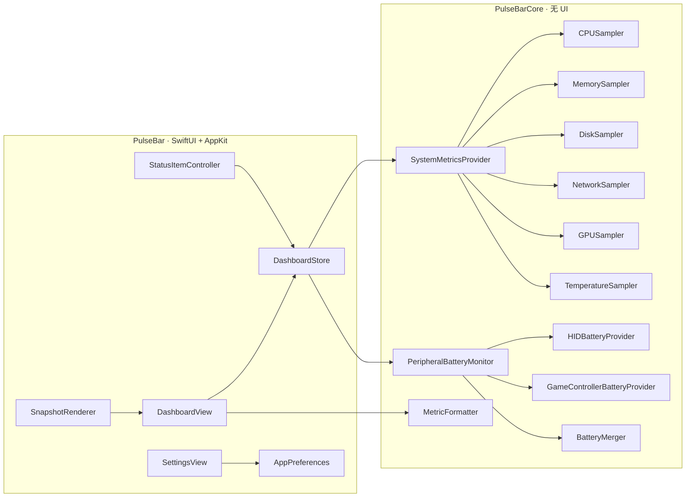
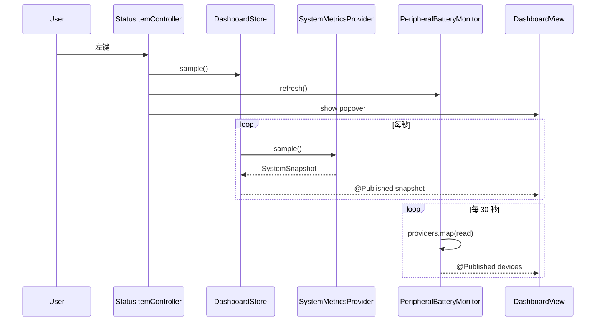

# PulseBar 架构说明

- 状态：M0 框架
- 更新：2026-11-11
- 相关：`roadmap.md`、`AGENTS.md`、`docs/battery-research.md`

## 1. 目标

用尽量小的原生代码，把「系统指标」与「外设电量」做成一个可测试、可扩展的菜单栏应用：

- Core 纯逻辑，可单测，不依赖 UI。
- UI 只读快照，不直接碰 IOKit / IORegistry。
- 电量来源以 Provider 插件式接入，新增来源不改 UI。
- 读不到的数据保持 `nil`，UI 显示“—/未知”。

## 2. 模块与依赖



| Target | 职责 | 禁止 |
| --- | --- | --- |
| `PulseBarCore` | 采样、解析、合并、格式化、数据模型 | SwiftUI/AppKit、UserDefaults、窗口 |
| `PulseBar` | 菜单栏、Popover、设置窗口、主题、交互 | 直接解析 IORegistry 原始字典 |

SwiftPM 中 Core 是 library，App 是 executable；`swift test` 只测 Core（UI 通过快照/手动验证）。

## 3. 文件地图

```text
Sources/PulseBarCore/
├── Models/SystemSnapshot.swift         # 一次采样
├── Models/PeripheralBattery.swift      # 外设模型与枚举
├── Metrics/MetricSamplers.swift        # CPU/内存/磁盘/网络/GPU/温度
├── Metrics/SystemMetricsProvider.swift # 组合采样
├── Metrics/DemoMetricsProvider.swift   # 演示数据
├── Battery/BatteryProviding.swift      # Provider 协议
├── Battery/HIDBatteryProvider.swift    # IORegistry
├── Battery/GameControllerBatteryProvider.swift
├── Battery/BatteryMerger.swift         # 去重/合并/排序
├── Battery/PeripheralBatteryMonitor.swift
└── Formatting/MetricFormatter.swift

Sources/PulseBar/
├── main.swift                          # 入口 / --snapshot
├── App/AppDelegate.swift               # 生命周期、依赖装配
├── App/StatusItemController.swift      # 菜单栏、Popover、右键菜单
├── App/AppPreferences.swift            # UserDefaults + SMAppService
├── App/SettingsWindowController.swift
├── App/SnapshotRenderer.swift          # ImageRenderer 离屏截图
├── App/AppEnvironment.swift            # 版本、演示开关
├── Features/Dashboard/*                # Store、面板、卡片、电量区
├── Features/Settings/SettingsView.swift
├── DesignSystem/Theme.swift            # 令牌
├── DesignSystem/Components.swift       # 卡片/进度条/电池图形
└── Demo/DemoBatteryProvider.swift
```

## 4. 启动与生命周期

1. `main.swift` 创建 `NSApplication`，设置 `.accessory`（无 Dock 图标），指定 `AppDelegate.shared`。
2. `AppDelegate.applicationDidFinishLaunching`：
   - 读取 `AppPreferences`；
   - 根据 `PULSEBAR_DEMO` 选择 Demo 或真实 Provider；
   - 构造 `PeripheralBatteryMonitor` 与 `DashboardStore`；
   - 构造 `StatusItemController`；
   - `store.start()`（首采样 + 启动定时器 + 电量轮询）；
   - `statusController.start()`（每秒更新菜单栏标签）。
3. 左键状态项：`NSPopover`（`.transient`）展示 `DashboardView`；打开时立即采样并刷新电量。
4. 右键：`NSMenu`（打开面板/设置/关于/退出）。
5. 退出：`store.stop()` 失效定时器，电量监听停止。



## 5. 指标采样

`SystemMetricsProvider.sample()` 同步组合六个采样器：

| 指标 | 当前实现 | 已知限制 |
| --- | --- | --- |
| CPU | `host_processor_info` per-core tick 差分 | 主线程采样；M1.1 移出 |
| 内存 | `host_statistics64`：active + wired + compressed | 与 Activity Monitor 可能有小差异 |
| 磁盘 | `/` 的 `volumeTotalCapacity` + `volumeAvailableCapacityForImportantUsage` | 只有内置卷；M1.6 加外置 |
| 网络 | `getifaddrs` + `if_data`（32 位） | 未处理 VPN/回绕；M1.7 |
| GPU | IOKit `IOAccelerator` → `PerformanceStatistics["Device Utilization %"]` | 部分机型无该键 |
| 温度 | 占位返回 `nil` | M1.5 私有 HID |

约定：

- 首次采样（无基线）返回 `nil`，UI 显示“—”。
- 采样失败只影响该指标，不影响其他指标。
- 所有比例归一化到 0...1；UI 负责百分比格式化。
- 时间戳在快照上，便于判断过期。

## 6. 外设电量管线

```mermaid
flowchart LR
    H[HIDBatteryProvider] --> M[BatteryMerger]
    G[GameControllerBatteryProvider] --> M
    A[未来的 GATT/Audio/iOS Provider] -.-> M
    M --> Mon[PeripheralBatteryMonitor]
    Mon -->|@Published devices| UI[PeripheralSection]
```

- `BatteryProviding`：`source` + `read() -> [PeripheralBattery]`，同步、轻量。
- `BatteryMerger`：按 `id` 去重；优先“有电量且更新”的记录；排序（类型 → 低电量优先 → 名称）。
- `PeripheralBatteryMonitor`：`@MainActor`，默认 30 秒定时器；`setEnabled` / `setInterval` / `refresh`。
- 设备 `level == nil` 表示“已发现但未知电量”，不能当 0%。
- 低电量判定排除充电/满电；`isLow <= 20%`，`isCritical <= 10%`。

## 7. 线程与定时器

- 当前：所有采样与 UI 在主线程。采样耗时低（毫秒级），但 M1.1 会移到串行后台上下文。
- `DashboardStore` / `PeripheralBatteryMonitor` / `StatusItemController` 均 `@MainActor`。
- 定时器使用 `Timer` + `RunLoop.main.add(_, forMode: .common)`，tolerance 降低唤醒。
- 定时器闭包用 `Task { @MainActor [weak self] ... }`，避免跨 actor 访问。
- 睡眠/唤醒（M1.8）会暂停/恢复；当前尚未监听，合盖后计时器可能堆积一次。

## 8. 数据与持久化

| 数据 | 位置 | 生命周期 |
| --- | --- | --- |
| 指标快照 / history | 内存 | 应用退出即丢失；history 上限 90 |
| 外设电量 | 内存 | 同上；不落盘 |
| 偏好 | `UserDefaults`（`pulsebar.*`） | 持久 |
| 登录项 | `SMAppService` | 持久（系统管理） |

不保存序列号、MAC、UDID；诊断（M1.9）需要脱敏。

## 9. 构建与打包

- `Package.swift`：macOS 14，Swift 5 语言模式，`PulseBarCore` + `PulseBar` + tests。
- `build.sh`：
  - 默认 release 原生架构；
  - `UNIVERSAL=1` 分别构建 arm64/x86_64 后 `lipo`；
  - 复制 `Info.plist` 与 `Resources/AppIcon.icns`；
  - `codesign --force --deep --sign -`（ad hoc）；
  - `codesign --verify --deep --strict`。
- `LSUIElement=true` 隐藏 Dock 图标。
- 受限环境：`PULSEBAR_LOCAL_CACHES=1` 把模块缓存/TMPDIR 放到项目内；`PULSEBAR_DISABLE_SANDBOX=1` 关闭 SwiftPM 自身沙盒。

## 10. 快照模式

`swift run PulseBar --snapshot <path>`：

1. `main.swift` 在启动 App 前检测参数；
2. `SnapshotRenderer` 用 `DemoMetricsProvider` + `DemoBatteryProvider` 构造 Store；
3. 用 `ImageRenderer` 渲染 `DashboardContent`（不带 `ScrollView`，因为 ImageRenderer 不绘制 ScrollView 内容）；
4. 通过环境值 `isSnapshot` 把 SwiftUI `Menu` 替换为纯图标，避免 ImageRenderer 画出占位符号；
5. 输出 PNG（2x）。

用途：README 截图、视觉回归（M2）、无需真实外设。

## 11. 扩展点

### 新增指标

1. 在 Core 写采样器（同步、返回可选值）。
2. 扩展 `SystemSnapshot` 字段（保持默认 `nil`）。
3. `SystemMetricsProvider` 组合。
4. UI 增加/调整卡片；不可用时显示“—”。
5. 加格式化测试与快照。

### 新增电量来源

1. 实现 `BatteryProviding`（不依赖 UI）。
2. 在 `AppDelegate` 注入；Demo 模式可替换。
3. 在 `BatteryMerger` 定义来源优先级/去重规则。
4. 更新 `docs/battery-research.md` 与 README 支持矩阵。
5. 加 fixture 单测与手动验证记录。

### 新增设置

1. `AppPreferences` 加 `@Published` + `UserDefaults` 键。
2. `SettingsView` 加行；必要时在 `onChange` 通知 Store/Monitor。
3. 默认值要保证首次启动行为合理。

## 12. 已知技术债（按 roadmap）

- 主线程采样（M1.1）。
- CPU 温度占位（M1.5）。
- 无外置卷（M1.6）。
- 32 位网络计数器、VPN 重复统计（M1.7）。
- 深色写死、无本地化（M2）。
- 电量无过期/stale 标记（M3.4）。
- 第三方 BLE/AirPods/iPhone 未支持（M4）。
- 无 CI/公证（M6）。

## 13. 决策记录

| 决策 | 理由 |
| --- | --- |
| 用 NSStatusItem + NSPopover，而非 SwiftUI `MenuBarExtra` | 需要右键菜单、精细控制面板与设置窗口 |
| Core/App 分层 + SwiftPM | 可测试、可被 Cursor 小步修改；无 Xcode 工程文件 |
| 电池用 Provider 协议 | 私有/实验 API 可隔离，失败不影响 UI |
| 未知电量用 `nil` | 产品底线：不伪造 0% |
| 快照用 `ImageRenderer` | 无需 GUI 会话，方便 README 与视觉回归 |
| ad hoc 签名 | M0 本地可用；M6 换 Developer ID + 公证 |
